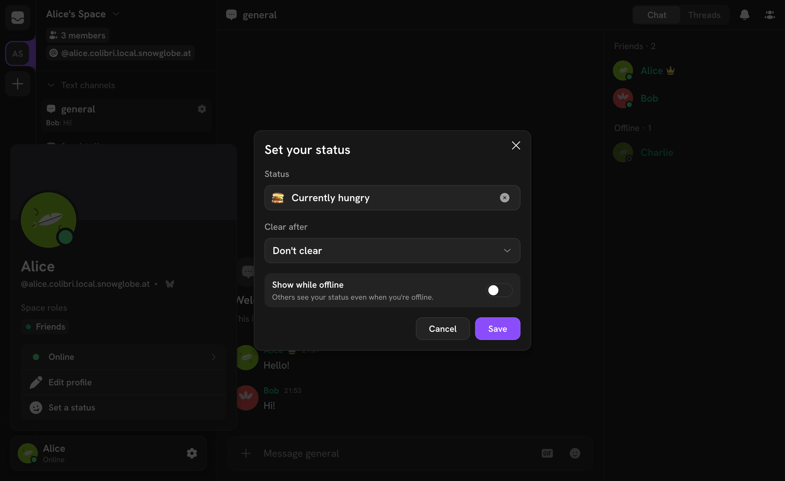

import { Steps, Tabs, TabItem, CardGrid, LinkCard } from "@astrojs/starlight/components";

Colibri shows two things about you next to your name:

- Your **online status** is the colored dot on your picture. It tells others whether you're around.
- Your **status** is a short line of text with an emoji, like a note on your door. It tells others what you're up to.

Both are set from your own profile.

<Tabs syncKey="device">
  <TabItem label="Computer">
    Select your name at the bottom left.
  </TabItem>
  <TabItem label="Phone">
    Select the **Profile** tab.
  </TabItem>
</Tabs>

## Set a status

<Steps>

1. Open your profile and select **Set a status**. If you already have one, the button reads **Edit status**.

2. Type a short text under **Status**, and pick a **Status emoji** if you like.

3. Under **Clear after**, pick when the status disappears by itself: **30 minutes**, **1 hour**, **4 hours**, **Today** or **This week**. **Don't clear** keeps it until you remove it.

4. Turn on **Show while offline** to let others see the status even when you're offline.

5. Select **Save**.

   

</Steps>

To take your status down early, open it again and select **Remove status**.

## Change your online status

Open your profile, select **Online status** and pick one:

| Online status | What it does |
| --- | --- |
| **Online** | Shows that you're around. |
| **Away** | Shows that you've stepped away. |
| **Do not disturb** | Shows that you don't want to be interrupted, and holds back notifications on your devices. |
| **Offline** | Makes you appear offline to others while you keep using Colibri. |

:::tip
**Do not disturb** pauses notifications on your devices without changing your notification settings. Switch back to **Online** to get them again.
:::

## Share what you're listening to or playing

Colibri can show what you're playing or listening to on your profile and in the member list.

Open **Settings** > **Chat** and turn on **Share what I'm doing**. Turning it off clears it for everyone right away!

Colibri reads your activity from other apps in the Atmosphere. See [Music](/docs/users/integrations/music) for teal.fm, Rocksky and atradio, and [Games](/docs/users/integrations/games) for atmosphere.games.

## Related articles

<CardGrid>
  <LinkCard
    title="Edit Your Profile"
    description="Change your name, picture and bio."
    href="/docs/users/account/profile"
  />
  <LinkCard
    title="Notifications"
    description="Everything that decides which notifications reach you."
    href="/docs/users/notifications"
  />
  <LinkCard
    title="Integrations"
    description="The apps Colibri reads your activity from."
    href="/docs/users/integrations"
  />
</CardGrid>
