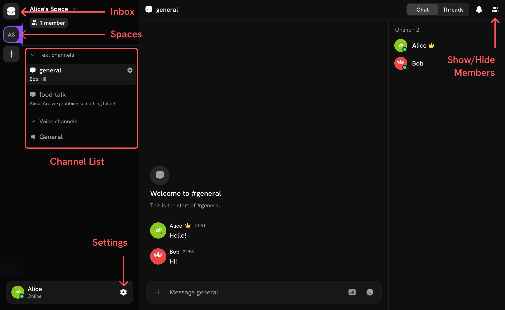

import { Tabs, TabItem, CardGrid, LinkCard } from "@astrojs/starlight/components";
import { Image } from "astro:assets";
import layoutPhone from "../../../../../assets/docs/layout-phone.png";
import spaceMenu from "../../../../../assets/docs/space-menu.png";

Colibri is laid out the same way everywhere: your Spaces, then the channels of the Space you picked, then the conversation. On a computer these sit side by side. On a phone you move through them one after another.

## The main areas

<Tabs syncKey="device">
  <TabItem label="Computer">
    - **Your Spaces** run down the left edge as a column of icons. The **Inbox** is at the top of that column, and **Create a Space** is at the end of it.
    - **The channel list** is next to it. The name of the Space is at the top, with its categories and channels below.
    - **The conversation** fills the middle. The box where you write is at the bottom.
    - **The member list** is on the right. Select **Show members** or **Hide members** at the top of a channel to toggle it.
    - **Your name** is at the bottom left, with **Settings** next to it. Select your name to open your profile.

    

  </TabItem>
  <TabItem label="Phone">
    Four tabs at the bottom take you to the main areas:

    - **Spaces** shows your Spaces as a column of icons, and the channels of the Space you picked next to it. Select a channel to open it, and select **Back to channels** to return.
    - **Inbox** collects your mentions and replies.
    - **Profile** shows your own profile and status.
    - **Settings** holds every setting.

    Inside a channel, select the channel name at the top to see its members.

    <Image src={layoutPhone} alt="The Spaces tab on a phone, with the tab bar at the bottom" width={320} />

  </TabItem>
</Tabs>

## Open a menu

Almost everything in Colibri has a menu: a Space, a category, a channel, a thread, a message and a member. The other articles say "open the menu of the channel" and mean this:

<Tabs syncKey="device">
  <TabItem label="Computer">
    Right-click the item. For a Space, you can also select its name at the top of the channel list.
  </TabItem>
  <TabItem label="Phone">
    Press and hold the item. For a Space, you can also select its name at the top of the channel list.
  </TabItem>
</Tabs>

A menu only lists what you're allowed to do. If an entry from an article is missing, your roles in that Space don't include it.

<Image src={spaceMenu} alt="The Space menu with Invite people, Manage Space, Notification settings, Mute Space, Create channel and Leave Space" width={320} />

## Unread messages

A channel with new messages is marked as unread in the channel list, and so is its Space. A number on a Space shows how many times you were mentioned there.

To clear the markers without reading everything, open the menu of the Space, category or channel and select **Mark as read**.

When you scroll up in a channel, Colibri shows that you're viewing older messages. Select **Jump to bottom** to return to the newest one.

## Change the order of your Spaces

Drag a Space icon up or down in the column. On a touch screen, press and hold the icon first, then drag.

## The Inbox

The **Inbox** lists the messages that mention you and the replies to your messages, across all your Spaces. Select an entry to jump to the message.

Its **Mentions** and **Replies** tabs filter the list, and **Mark all as read** clears it. [Notifications](/docs/users/notifications) has more information on what ends up there.

## Related articles

<CardGrid>
  <LinkCard
    title="Send Messages"
    description="Write your first message."
    href="/docs/users/messaging/send-messages"
  />
  <LinkCard
    title="Notifications"
    description="Choose what Colibri notifies you about."
    href="/docs/users/notifications"
  />
</CardGrid>
