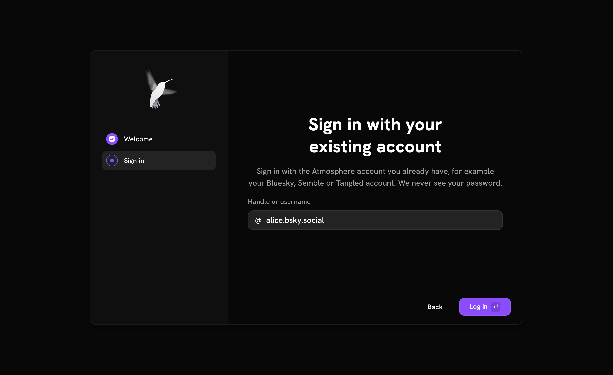
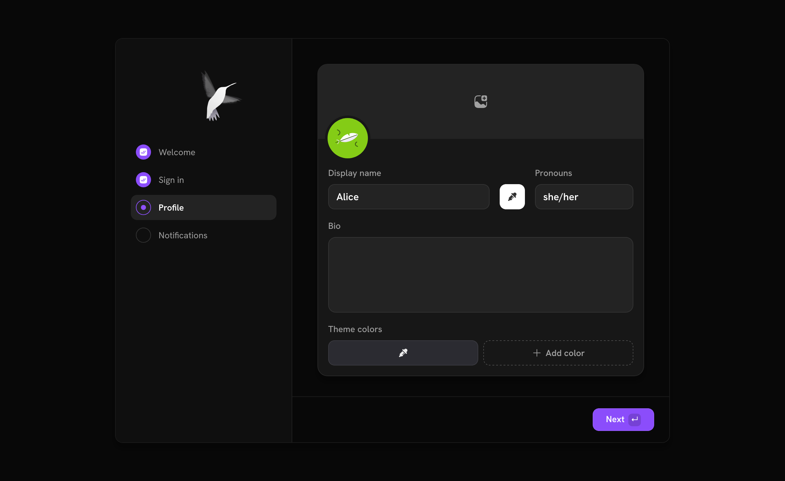

import { Steps, CardGrid, LinkCard } from "@astrojs/starlight/components";

Colibri has no accounts of its own. You sign in with an **Atmosphere account**, which is the account you use on apps like Bluesky, Semble or Tangled.

## Sign in

<Steps>

1. Open Colibri and select **Start setup**.

2. Enter your handle under **Handle or username** (for example `alice.bsky.social`) and select **Log in**.

   

3. The page of your account provider opens. Enter your password there and approve the permissions Colibri asks for.

4. Back in Colibri, set up your profile. Add a picture, a **Display name** and your **Pronouns**, then select **Next**.

   

5. Select **Enable notifications** to hear about new messages, or **Skip** to decide later.

</Steps>

In the Colibri apps, step 3 happens in your browser. If the browser didn't open, select **Try again**.

:::note
Your password goes to your account provider. Colibri never sees it!
:::

{/*## Create an account

<Steps>

1. Open Colibri and select **Start setup**.

2. Select **Create account**.

3. Select **Open browser**. Colibri sends you to an account provider, where you sign up.

4. Return to Colibri and [sign in](#sign-in) with your new handle.

</Steps>*/}

## The permission screen

During sign-in, your account provider shows a screen that lists what Colibri asks to do with your account.

A new Colibri feature can need a permission you haven't approved yet. Colibri will show a notice that it needs new permissions and names the feature. Select **Review** to open the permission screen again and approve it!

## Stay in sync with Bluesky

If you have a Bluesky profile, the profile step offers **Stay in sync with Bluesky?**. With it turned on, changes to your Bluesky profile show up on your Colibri profile too. [Edit Your Profile](/docs/users/account/profile) has more information on how to change this later.

## Log out

Open **Settings** and select **Log out** at the end of the list. This signs you out on the device you're using.

## Related articles

<CardGrid>
  <LinkCard
    title="Fix Sign-In Problems"
    description="What to do when signing in doesn't work."
    href="/docs/users/getting-started/sign-in-problems"
  />
  <LinkCard
    title="Find Your Way Around"
    description="A tour of the app after you sign in."
    href="/docs/users/getting-started/finding-your-way"
  />
  <LinkCard
    title="Join a Space"
    description="Use an invite link to get in."
    href="/docs/users/spaces/join-a-space"
  />
</CardGrid>
