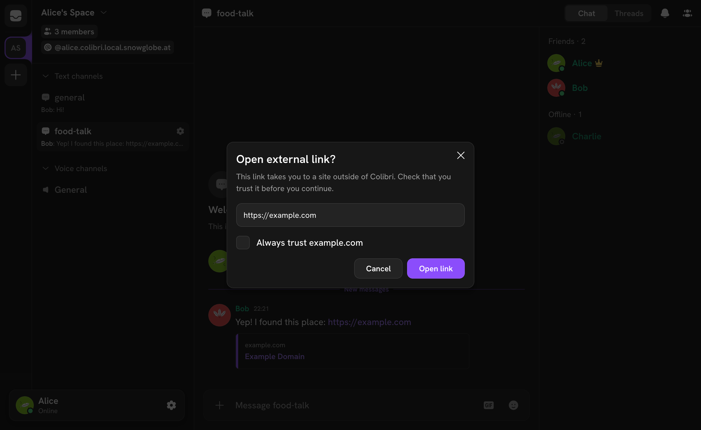

import { CardGrid, LinkCard, Steps } from "@astrojs/starlight/components";
import { Image } from "astro:assets";
import attachmentTray from "../../../../../assets/docs/attachment-tray.png";

A message can carry more than text! You can attach images, videos, audio files, and any other file, and a link in your message can show a preview card of the page it leads to.

## Attach a file

<Steps>

1. Select the **plus icon** next to the message box and pick one or more files. On a computer, you can also drag files into the channel and drop them when Colibri shows **Drop files to attach**.

2. The files appear above the message box. Add text if you like.

   <Image src={attachmentTray} alt="The message box with an attached image and the Add alt text and Mark as spoiler options" width={320} />

3. Send the message.

</Steps>

A message takes up to 10 files, and each file can be up to 75 MB. Please note that some account providers may not accept files up to this limit!

To remove a file before sending, select the **x button** on it. If an upload fails, select the file to try again.

## Describe an image with alt text

Alt text is a short description of an image. It is useful for people who are not able to view the image and have to rely on a description instead.

<Steps>

1. Attach an image.

2. Select **Add alt text** on the image above the message box.

3. Describe what the image shows under **Alt text**, then select **Save**.

</Steps>

## Hide a file behind a spoiler

A spoiler covers an image or a file until a reader chooses to look at it. Use it for plot twists, leaks, spoilers, et cetera!

Select **Mark as spoiler** on the file above the message box before you send. Readers then have to select the covered file to reveal it.

For text, wrap the words in two vertical bars on each side, like <code>\|\|this\|\|</code>.

## Open and download attachments

- Select an image to view it at full size.
- Videos and audio files play inside the channel.
- A text file shows the beginning of its content in the channel. Select it to read all of it.
- Select the download button on a file to save it. For an image, open the menu of the message and select **Download image**.

## Link previews

When you post a link, Colibri can show a preview card under your message with the title and picture of the page. You can adjust this behavior using three settings:

### For one message

After you type a link, a link button appears next to the message box. Tap it to send this message without a preview.

To change a message you already sent, open its menu and select **Link previews**.

### For all your messages

Open **Settings** > **Chat** and turn **Show link previews on messages I send** on or off.

### For a Space or a channel

Members who manage a Space can turn previews off for everyone:

- For the whole Space, open **Manage Space** > **Messages** and switch **Show link previews**.
- For one channel, open **Edit channel** and pick an option under **Link previews**: **Follow the Space**, **Show previews** or **Hide previews**.

A channel's setting wins over the Space's setting, acting as an override.

## Opening external links

When you select a link that leads outside Colibri, Colibri shows a popup with the full address. This protects you from links that pretend to go somewhere else.

- Select **Open link** to continue.
- Turn on **Always trust** for that site to skip the warning for it from then on.
- To turn the warning off completely, open **Settings** > **Chat** and switch off **Warn me before I leave Colibri**.

## Related articles

<CardGrid>
  <LinkCard
    title="Send Messages"
    description="Write, format, edit and delete messages."
    href="/docs/users/messaging/send-messages"
  />
  <LinkCard
    title="Custom Emoji"
    description="Upload your own emoji and follow other people's."
    href="/docs/users/messaging/custom-emoji"
  />
</CardGrid>
