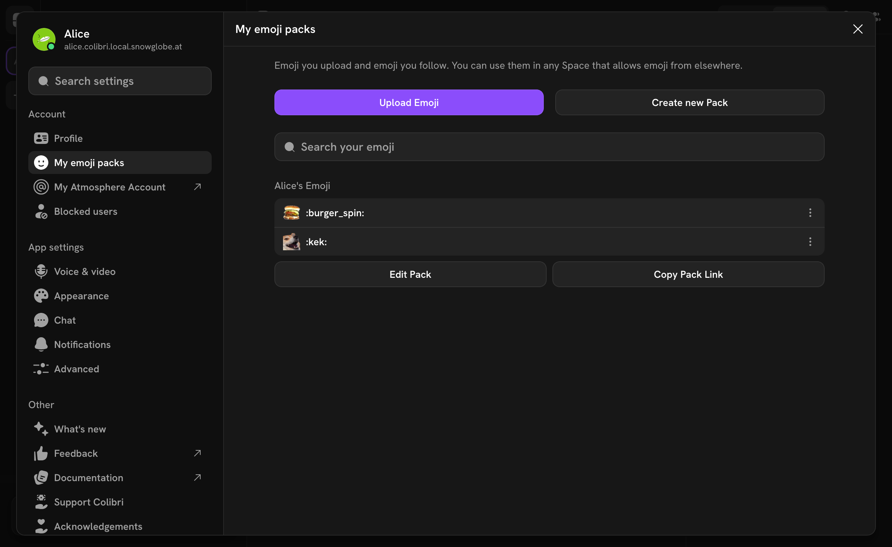

import { Steps, CardGrid, LinkCard } from "@astrojs/starlight/components";

A custom emoji is a small image you use like any other emoji, in messages or as a reaction. Colibri has two collections of them:

- **Your own emoji** travel with you. You can use them in every Space that allows emoji from elsewhere.
- **A Space's emoji** belong to that Space. Every member can use them there.

A **pack** is a named group of emoji, like a sticker album. Packs can be used to group relevant emoji together, and a pack can be shared with a link!

Colibri saves your emoji and packs as [Bluemoji](/docs/users/integrations/bluemoji), so they also work in other apps that support it.

## Use a custom emoji

Type `:` followed by the name of the emoji and pick it from the list under **Custom emoji**. Custom emoji also appear in the emoji picker.

## Upload your own emoji

<Steps>

1. Open **Settings** and select **My emoji packs**.

2. Select **Upload Emoji** and choose an image.

3. Enter a **Name**. This is what you type between colons to use the emoji, like `:party_parrot:`.

4. Select **Upload emoji**.

   

</Steps>

An emoji image must be a PNG, WebP or GIF of up to 128 KB. Square images work best, and bigger ones are scaled down to fit. A name can use lowercase letters, numbers and underscores!

## Group emoji in a pack

<Steps>

1. In **My emoji packs**, select **Create new Pack**.

2. Enter a **Pack Name**.

3. Upload emoji into the pack, then select **Create Pack**!

</Steps>

To change a pack later, select **Edit Pack**. To share it, select **Copy Pack Link** and paste the link into a message. The link shows as a card with the emoji of the pack!

Deleting a pack keeps its emoji. They stay with the rest of your emoji.

## Follow someone else's emoji

Following adds another person's emoji to your own collection, so you can use it too.

- **One emoji**: select the custom emoji in a message, then select **Follow emoji**. **Show pack** opens the pack it belongs to.
- **A whole pack**: select **Follow pack** on the card of a shared pack.

Followed emoji are listed in **My emoji packs** under **Followed packs** and **Followed emoji**. Select **Remove** there to stop following.

If the owner deletes an emoji you follow, it's marked **Deleted emoji** in your list.

## Rename or delete an emoji

Open the menu of the emoji in **My emoji packs** and select **Rename emoji**, **Remove from pack** or **Delete emoji**.

## Manage the emoji of a Space

Members with the **Manage Space** permission add emoji for everyone in the Space.

<Steps>

1. Open the menu of the Space and select **Manage Space**, then **Emoji packs**.

2. Select **Upload Emoji** to add an emoji, or **Create new Pack** to start a pack.

</Steps>

When you delete an emoji from a Space, it's removed from every pack in that Space, and messages that used it show its name as plain text.

## Choose which custom emoji a Space allows

A Space decides whether members can bring emoji from elsewhere.

<Steps>

1. Open **Manage Space** and select **Messages**.

2. Under **Custom emoji**, pick one:

   - **All custom emoji**: members can use emoji from this Space, from their other Spaces, and the emoji they follow.
   - **Only this Space's emoji**: custom emoji from anywhere else show as plain text.
   - **No custom emoji**: every custom emoji shows as plain text.

</Steps>

## Related articles

<CardGrid>
  <LinkCard
    title="Send Messages"
    description="Add emoji and GIFs to a message."
    href="/docs/users/messaging/send-messages"
  />
  <LinkCard
    title="Replies, Reactions and Forwarding"
    description="React to a message with an emoji."
    href="/docs/users/messaging/replies-and-reactions"
  />
  <LinkCard
    title="Bluemoji"
    description="Use the same custom emoji across apps."
    href="/docs/users/integrations/bluemoji"
  />
</CardGrid>
