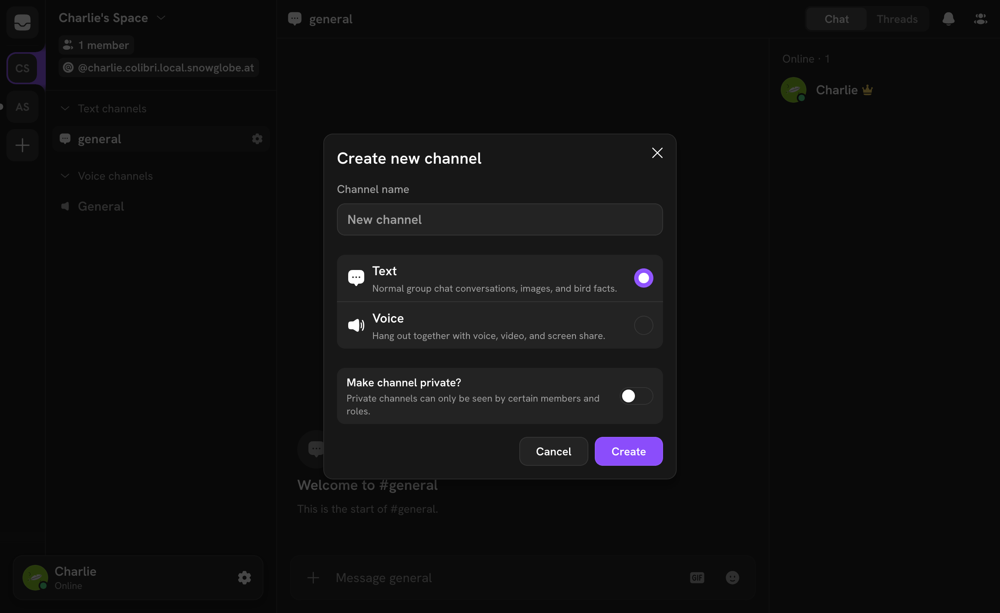

import { Steps, CardGrid, LinkCard } from "@astrojs/starlight/components";

If a Space is a house, channels are its rooms. Each channel is one room for one topic. A category is a group of channels with a heading, which keeps a long list readable!

There are two types of channels:

- **Text**: written conversations with images, files and reactions.
- **Voice**: a room to talk in, with camera, screen sharing and a text chat of its own.

The steps on this page need permissions such as **Create channels**, **Edit channels** or **Create categories**. If a menu entry is missing for you, ask the owner of the Space.

## Create a channel

<Steps>

1. Open the menu of the Space and select **Create channel**. To create the channel inside a specific category, open the menu of that category and select **Create channel** there.

2. Enter a **Channel name**.

3. Pick the type: **Text** or **Voice**.

   

4. To limit who sees the channel, turn on **Make channel private?**. Select **Next** and pick the members and roles who get in.

5. Select **Create**.

</Steps>

## Create a category

<Steps>

1. Open the menu of the Space and select **Create category**.

2. Enter a **Category name**.

3. To limit who sees the category, turn on **Make category private?**. Select **Next** and pick the members and roles who get in.

4. Select **Create**.

</Steps>

Channels in a private category are private too, unless a channel has its own setting.

## Edit a channel

Open the menu of the channel and select **Edit channel**. There you can change:

- the **Channel name**
- the **Channel description**, which tells members what the channel is about
- the **Category** the channel belongs to
- **Link previews** for the channel
- **Channel permissions**, to change what single roles or members can do in this channel

[Roles and Permissions](/docs/users/spaces/roles-and-permissions#channel-and-category-permissions) has more information on channel permissions.

## Copy a channel

Open the menu of the channel and select **Duplicate**. Colibri creates a new channel in the same category, with the same type, description and permissions. Its name ends in `-copy`, and it starts without messages.

## Reorder channels and categories

<Steps>

1. Open the menu of the Space and select **Reorder channels**.

2. Drag channels and categories to their new place. A channel can be dragged into another category.

3. Select **Done**.

</Steps>

Everyone in the Space sees the new order!

## Share a link to a channel

Open the menu of the channel and select **Copy channel link**. The link opens the channel for members who can view it.

## Delete a channel

<Steps>

1. Open the menu of the channel and select **Delete channel**.

2. Type the name of the channel under **Channel name** to confirm, then select **Delete channel**.

</Steps>

:::caution
Deleting a channel is permanent. Nobody can read its messages afterwards except the people who wrote them.
:::

## Delete a category

Open the menu of the category and select **Delete category**, then confirm. The channels inside the category stay. They move to the top of the channel list.

## Related articles

<CardGrid>
  <LinkCard
    title="Roles and Permissions"
    description="Decide who can see and use each channel."
    href="/docs/users/spaces/roles-and-permissions"
  />
  <LinkCard
    title="Voice Channels"
    description="Talk, turn on your camera and share your screen."
    href="/docs/users/voice"
  />
  <LinkCard
    title="Threads"
    description="Keep side conversations out of the main channel."
    href="/docs/users/messaging/threads"
  />
</CardGrid>
