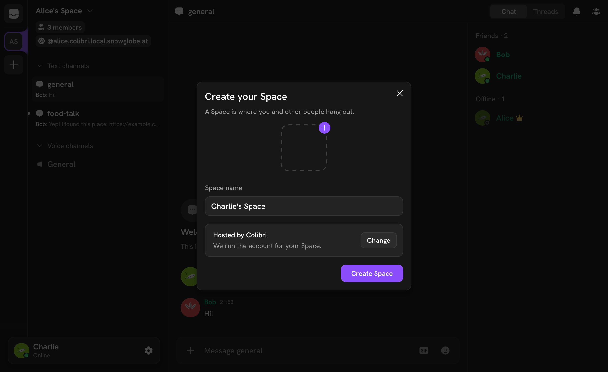

import { Steps, CardGrid, LinkCard } from "@astrojs/starlight/components";

Anyone can create a Space! The Space is yours: you're its owner, and you decide who gets in and what they can do there.

## Create the Space

<Steps>

1. Select **Create a Space** at the end of your list of Spaces.

2. Enter a **Space name**.

3. If you want, add an icon. The image must be smaller than 1 MB.

4. Leave **Who hosts this Space** on **Colibri hosts it**. [Where a Space Is Hosted](/docs/users/spaces/appviews) has more information on the other option.

   

5. Select **Create Space**.

</Steps>

## Contents of a new Space

Your Space comes furnished with the basics:

- A text channel named **general**, in a category named **Text channels**
- A voice channel named **General**, in a category named **Voice channels**
- A role named **Members**, which everyone who joins gets

You can rename all of these and add more. Channels and categories can be deleted, while the **Members** role cannot.

## Set up the Space profile

The profile is what people see on an invite link before they join.

<Steps>

1. Open the menu of the Space and select **Manage Space**, then **Space profile**.

2. If you want, add an icon and a banner.

3. Enter a **Name** and a **Description**.

4. Save your changes.

</Steps>

## Approve new members before they join

By default, anyone with a working invite link gets in. To look at each person first, turn on **Require join approval** in the **Space profile**.

People who open an invite link then send a request. Members with the **Manage approvals** permission approve or dismiss it. The [Moderate a Space](/docs/users/spaces/moderation#review-join-requests) page has more information on this.

## Next steps

<CardGrid>
  <LinkCard
    title="Invite People"
    description="Create invite links and bring people in."
    href="/docs/users/spaces/invites"
  />
  <LinkCard
    title="Channels and Categories"
    description="Add and sort the rooms of your Space."
    href="/docs/users/spaces/channels"
  />
  <LinkCard
    title="Roles and Permissions"
    description="Decide what members can see and do."
    href="/docs/users/spaces/roles-and-permissions"
  />
  <LinkCard
    title="Custom Emoji"
    description="Give your Space its own emoji."
    href="/docs/users/messaging/custom-emoji"
  />
</CardGrid>
