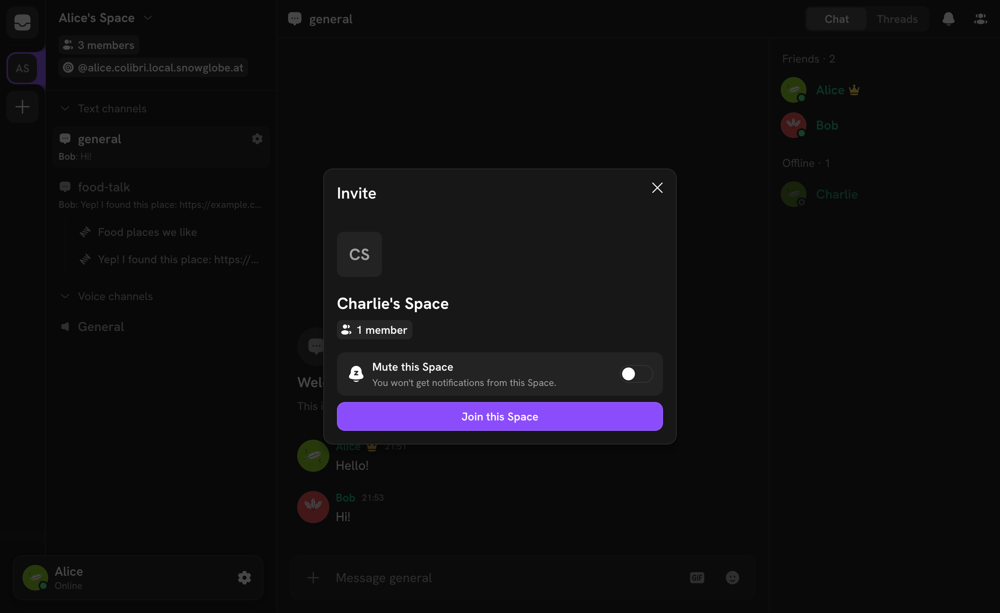

import { Steps, CardGrid, LinkCard } from "@astrojs/starlight/components";

A Space is private. You get in with an invite link, which works like a ticket to the front door! A member of the Space creates the link and sends it to you.

## Join with an invite link

<Steps>

1. Open the invite link. Colibri shows the name and the description of the Space.

   

2. To join without getting notifications from this Space, turn on **Mute this Space**.

3. Select **Join this Space**.

</Steps>

The Space appears in your list of Spaces, and you can start reading and writing straight away!

## Request to join

Some Spaces check who comes in. On their invite links, the button reads **Request to join**.

<Steps>

1. Open the invite link and select **Request to join**.

2. Wait for a member of the Space to approve you. The button reads **Request pending** until then.

</Steps>

Once you're approved, the Space appears in your list!

## Invite links that don't work

| Colibri says | What it means | What to do |
| --- | --- | --- |
| **This invite link has expired** | The link was valid for a limited time, and that time is over. | Ask someone in the Space for a new link. |
| **This invite link was used up** | The link was limited to a number of uses, and they're gone. | Ask someone in the Space for a new link. |
| **This invite link isn't valid** | The link was deleted, or it's mistyped. | Check the link, or ask for a new one. |
| **You can't join this Space** | You were banned from the Space. | Only the people who run the Space can lift a ban. |

## Leave a Space

<Steps>

1. Open the menu of the Space and select **Leave Space**.

2. Select **Leave Space** again to confirm.

</Steps>

After leaving, you can't read or send messages in the Space. To come back, you need an invite link again.

The owner of a Space can't leave it. [Transfer or Delete a Space](/docs/users/spaces/transfer-or-delete) has more information on the two ways out.

## A Space with a lock on it

A Space in your list that shows a lock is a community from before Colibri switched to Spaces. [Legacy Communities](/docs/users/spaces/legacy-communities) has more information on how it gets unlocked.

## Related articles

<CardGrid>
  <LinkCard
    title="Find Your Way Around"
    description="Where your Spaces and channels are."
    href="/docs/users/getting-started/finding-your-way"
  />
  <LinkCard
    title="Notifications"
    description="Set how much a Space notifies you."
    href="/docs/users/notifications"
  />
  <LinkCard
    title="Create a Space"
    description="Start a Space of your own."
    href="/docs/users/spaces/create-a-space"
  />
</CardGrid>
