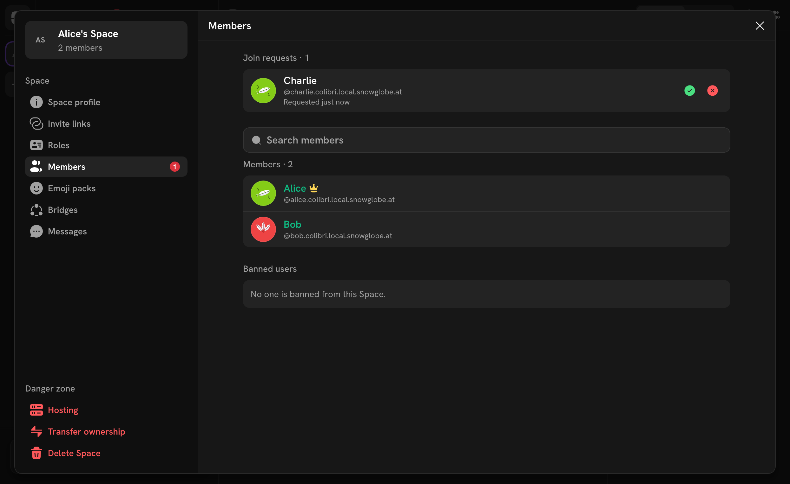

import { Steps, CardGrid, LinkCard } from "@astrojs/starlight/components";

Moderators decide who comes into a Space, take messages out of view, and remove people when that's needed. Each tool on this page needs a permission, which the owner hands out through roles.

| To do this | You need |
| --- | --- |
| Approve or dismiss join requests | **Manage approvals** |
| Hide and unhide messages | **Apply labels** |
| Kick a member | **Kick members** |
| Ban and unban | **Ban members**, **Unban members** |
| Mute, move or disconnect people in voice | **Moderate voice** |
| Move messages, lock and delete threads | **Move messages**, **Manage threads** |

You can only kick or ban a member whose highest role is below your own. [Roles and Permissions](/docs/users/spaces/roles-and-permissions#role-order) has more information on the ranking.

## Review join requests

If **Require join approval** is turned on for the Space, people who open an invite link land in a waiting list. A number next to **Manage Space** in the Space menu shows how many are waiting.

<Steps>

1. Open the menu of the Space and select **Manage Space**, then **Members**.

2. Under **Join requests**, look at who wants in.

3. Select **Approve** to let the person in, or **Dismiss** to turn the request down.

   

</Steps>

A dismissed request moves to **Dismissed requests**. From there you can still approve it, or put it back in the waiting list!

## Hide a message

Hiding takes a message out of view for the members of the Space. Use it for a message that breaks your rules.

<Steps>

1. Open the menu of the message and select **Hide message**.

2. Select **Hide message** again to confirm.

</Steps>

Two groups still see the message, collapsed and marked **Hidden by a moderator**: the moderators of the Space and the person who wrote it. Select **Show** on it to read it.

To bring a message back, open its menu and select **Unhide message**.

:::note
Hiding removes a message from view in Colibri. The message itself stays stored with the account of the person who wrote it. Only its author can delete it.
:::

On a computer, you can hold <kbd>Shift</kbd> while you select **Hide message** to skip the confirmation dialog.

## Kick a member

Kicking removes someone from the Space. It's the lighter of the two removals, because the person can come back.

<Steps>

1. Open the menu of the member and select **Kick**, followed by their name.

2. Select **Kick** to confirm.

</Steps>

A kicked member can join again with an invite link. In a Space that approves new members, their request needs approval again. Their messages stay where they are.

## Ban a member

A ban removes someone and keeps them out.

<Steps>

1. Open the menu of the member and select **Ban**, followed by their name.

2. Select **Ban** to confirm.

</Steps>

A banned person can't read the Space at all, and invite links don't work for them. Their existing messages stay as they are.

## Lift a ban

<Steps>

1. Open **Manage Space** and select **Members**.

2. Under **Banned users**, find the person. The list shows when they were banned and by whom.

3. Select **Unban** and confirm.

</Steps>

Lifting a ban doesn't add the person back to the Space. They can join again with an invite link.

## Moderate a voice channel

Open the menu of a member who is in a voice channel. Under **Voice**, moderators find:

- **Server mute**: turns the member's microphone off for everyone. They can't unmute themselves.
- **Server deafen**: turns the sound of the call off for the member.
- **Move to**: moves the member to another voice channel.
- **Disconnect**, followed by their name: removes the member from the call.

A member you mute or deafen sees **Muted by a moderator** or **Deafened by a moderator** until you lift it.

On a computer, you can also drag a member from one voice channel onto another in the channel list to move them.

## Tidy up a channel

Two tools help when a conversation is in the wrong place or has run its course:

- Move messages to another channel or thread with **Select messages** and **Move to**.
- Stop a thread with **Lock thread**, or remove it with **Delete thread**.

[Threads](/docs/users/messaging/threads) has more information on both.

## See hidden messages by default

Moderators can keep hidden messages expanded in the Spaces they moderate. Open **Settings** > **Chat** and turn on **Show hidden messages**.

## Moderation across a bridge

If your Space is connected to another chat service through a bridge, hiding a message can remove its copy there too. [Bridges](/docs/users/bridges#moderation) has more information on what crosses over.

## Related articles

<CardGrid>
  <LinkCard
    title="Roles and Permissions"
    description="Hand out moderation permissions."
    href="/docs/users/spaces/roles-and-permissions"
  />
  <LinkCard
    title="Invite People"
    description="Control who can get an invite link."
    href="/docs/users/spaces/invites"
  />
  <LinkCard
    title="Block Someone"
    description="A personal tool for a person you don't want to hear from."
    href="/docs/users/account/blocking"
  />
</CardGrid>
